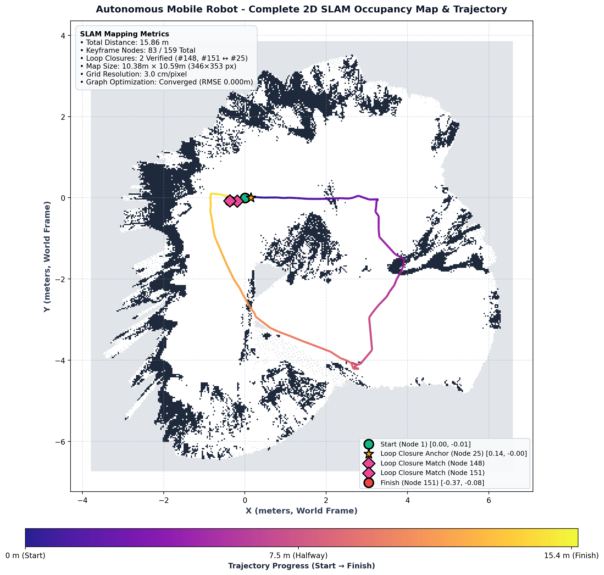
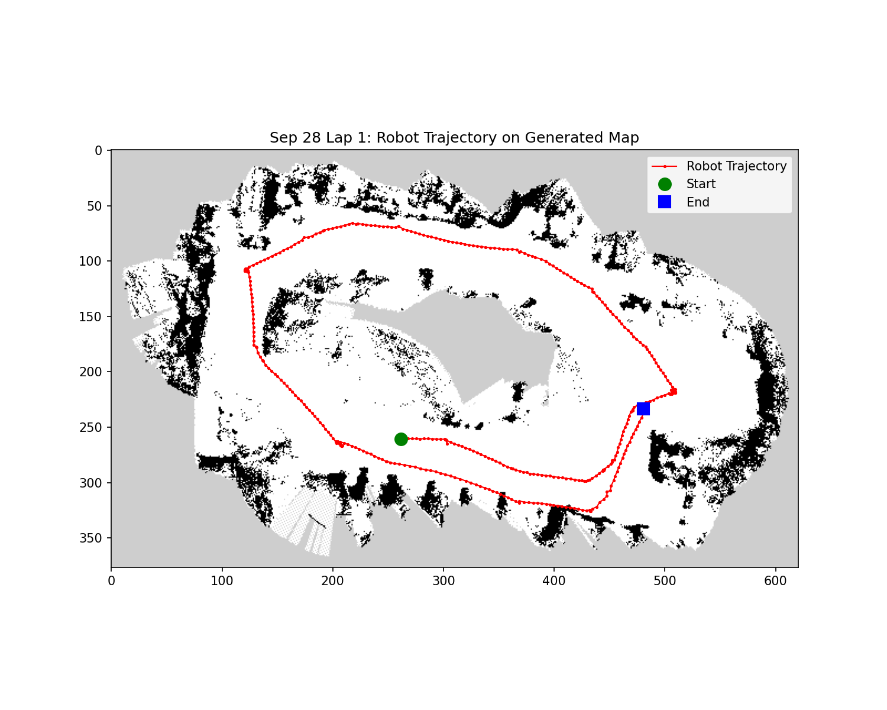

# ESP32 AMR: SLAM + Landmark Navigation on a Real Robot

[](https://docs.ros.org/en/jazzy/)
[](https://docs.nav2.org/)
[](http://introlab.github.io/rtabmap/)
[](LICENSE)

This is a physical differential-drive robot built from scratch. It maps a
10 × 10 m lab with an **OAK-D Lite** RGB-D camera, then **drives itself between
saved landmarks** while avoiding obstacles, all on ROS 2 Jazzy.

<p align="center">
  
  
</p>

## Hardware

| | |
|---|---|
| Base | 2-wheel differential drive, 0.56 m track, 125 mm wheels, IG52 planetary gear motors |
| Drivers | 2 × IBT-2 (BTS7960) H-bridges, 20 kHz PWM |
| MCU | ESP32 with quadrature encoders (15,902 ticks/rev), 50 Hz `ODO,<l>,<r>,<ms>` telemetry |
| Sensor | Luxonis OAK-D Lite (stereo depth + RGB + BMI270 IMU) at 1.24 m |

## What's inside

- **Firmware** (`firmware/amr_base_pid`): closed-loop wheel-speed PID, a 250 ms command watchdog, encoder-direction fault detection and a serial debug console.
- **Serial odometry bridge** (`odom_bridge_node.py`): converts `/cmd_vel` to serial and back to `/wheel_odom`, with midpoint (RK2) pose integration and timestamp sync against serial jitter.
- **Sensor fusion**: `robot_localization` EKF fuses wheel odometry with the calibrated OAK-D IMU.
- **SLAM**: RTAB-Map RGB-D mapping and localization with loop closure. Includes 2D map export and point-cloud tools.
- **Navigation**: Nav2 with the Smac Lattice planner, the Regulated Pure Pursuit controller and voxel-layer costmaps fed by a live 3D obstacle cloud. A custom **behaviour tree** (`navigate_landmarks_bt.xml`) holds the path steady (no replan flip-flop) and recovers with clear, back-up and wait steps.
- **Landmark manager**: `save`, `goto`, `circuit` and `patrol` named landmarks, plus keepout zones and mission logging.
- **Calibration and diagnostics**: tick and odometry calibration against a tape-measured ground truth, IMU bias calibration, yaw-sign checks, motor diagnostics and costmap snapshots.

```
OAK-D Lite ──► RTAB-Map (SLAM / localization) ──► map → odom
     │                                              │
     └─ IMU ─┐                                      ▼
ESP32 ◄─serial─► odom_bridge_node ─► /wheel_odom ─► EKF ─► odom → base_link
   ▲                                                 │
   └──────────── /cmd_vel ◄── Nav2 (Smac Lattice + RPP + custom BT) ◄── landmark_manager
```

## Quick start

```bash
mkdir -p ~/mapping_ws/src && cd ~/mapping_ws/src
git clone https://github.com/KriShna-Sy/esp32-amr-slam-nav.git
cp -r esp32-amr-slam-nav/src/esp32_odom_bridge .
cd ~/mapping_ws && rosdep install --from-paths src -y --ignore-src
colcon build --symlink-install --packages-select esp32_odom_bridge && source install/setup.bash

# 1. Map: drive one slow loop and return to the start
ros2 launch esp32_odom_bridge mapping.launch.py delete_db:=true
ros2 run esp32_odom_bridge teleop.sh
ros2 run esp32_odom_bridge save_nav_map.sh

# 2. Save landmarks
ros2 launch esp32_odom_bridge autonomous_bringup.launch.py
ros2 run esp32_odom_bridge landmark_manager save desk

# 3. Navigate
ros2 run esp32_odom_bridge landmark_manager goto desk
ros2 run esp32_odom_bridge landmark_manager patrol desk door lab --loop
```

The full command reference is in [`src/esp32_odom_bridge/README.md`](src/esp32_odom_bridge/README.md).
The engineering log covers calibration, the "radial warp" and "7 cars" ghosting
fixes, and loop-closure tuning. It is in [`docs/ENGINEERING_LOG.md`](docs/ENGINEERING_LOG.md).

### Setup notes
- The OAK-D driver runs from a separate Python venv (`ros_oak_env`) through `oak_ros_bridge.py`, which is not in this repo. Paths to it are set in `launch/mapping.launch.py` and `launch/localization.launch.py`, so edit those for your machine.
- `config/nav2_params.yaml` points `default_nav_to_pose_bt_xml` at an absolute path. Change it to your workspace.
- Maps (`*.db`, point clouds) are not committed because they're hundreds of MB. Example landmark and keepout files are in `examples/`.

## License
MIT, see [LICENSE](LICENSE).
